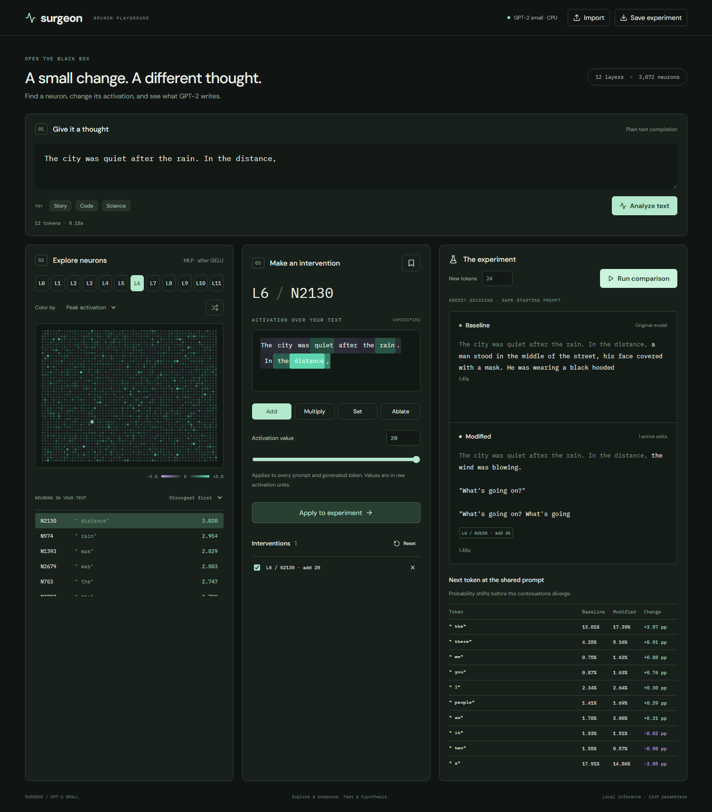

# Surgeon

Surgeon is a local playground for the neurons of GPT-2 small.
You paste text, find the neurons that respond to the text, and change one activation.
Surgeon then shows the original completion and the modified completion side by side.



## What Surgeon does

- **Analyze.** One forward pass captures all 36,864 MLP activations (12 layers × 3,072 neurons) for each token.
- **Explore.** A 64 × 48 grid shows one layer. A ranked list shows the strongest neurons and the token that causes each peak.
- **Intervene.** Add to, multiply, set, or ablate the activation of a maximum of 16 neurons.
- **Compare.** The baseline and the modified model decode from the same prompt. The output streams token by token.
- **Measure.** A table shows the change in next-token probability at the end of the shared prompt.
- **Save.** Export an experiment as JSON and import the file later. Bookmarks stay in the browser.

## Example result

Prompt: `The city was quiet after the rain. In the distance,`

Each row adds a constant to layer 6, neuron 2130.

| Added value | P(` a`) | P(` the`) | Start of the completion |
|---:|---:|---:|---|
| 0 | 17.91% | 13.81% | ` a man stood in the middle of the street` |
| 7 | 15.56% | 15.14% | ` a small group of people were gathering around the fire.` |
| 8 | 15.30% | 15.31% | ` the wind was blowing.` |
| 20 | 14.86% | 17.39% | ` the wind was blowing.` |

A change of one unit moves ` the` above ` a`, and greedy decoding then writes a different story.
[exploration/FINDINGS.md](exploration/FINDINGS.md) records five such findings from 36 comparisons.
Each finding has a JSON export that you can import into Surgeon.

These results are observations on the tested prompts.
A high activation helps you find a neuron. A high activation does not prove what the neuron means.

## How Surgeon works

```text
Browser (React, TypeScript, Vite)
        │  JSON requests, NDJSON stream
        ▼
FastAPI server (backend/server.py)
        │  one job at a time
        ▼
Runtime (backend/runtime.py): PyTorch + Hugging Face Transformers, GPT-2 small
```

A neuron is one post-GELU MLP activation, immediately before `transformer.h[layer].mlp.c_proj`.
The runtime registers one forward pre-hook on each `c_proj` module.
The hook captures the activation tensor for analysis and applies the enabled edits.

| Control | Operation on the activation `h` |
|---|---|
| Add | `h = h + value` |
| Multiply | `h = h * value` |
| Set | `h = value` |
| Ablate | `h = 0` |

Design decisions:

- **Raw units.** Values are raw activations. Surgeon uses no normalized dose.
- **All positions.** An edit applies at each prompt position and at each decode position.
- **Fair comparison.** Each branch starts from the same prompt with a new KV cache. Decoding is greedy, thus a run is repeatable.
- **No state leak.** A lock gives the model to one job. The runtime clears edits and captures after success, failure, and cancellation.
- **Small responses.** The browser fetches one layer summary and one neuron trace. The 36,864 × tokens activation tensor stays on the server.
- **Pinned model.** The runtime loads one fixed revision of `openai-community/gpt2`.

## Install

Requirements: Python 3.12 and Node.js 20 or later.

```bash
python -m venv .venv
.venv/Scripts/python -m pip install -r requirements-lock.txt   # Windows
.venv/bin/python -m pip install -r requirements-lock.txt       # macOS, Linux
npm ci
npm run model     # downloads GPT-2 small (about 500 MB) into .cache/
npm run build
```

## Run

```bash
npm start
```

Open http://127.0.0.1:8791.
Surgeon uses the CPU by default.
Surgeon uses an NVIDIA GPU when the installed PyTorch has CUDA support.

For development, run `npm run dev` and open http://127.0.0.1:5173.
This command starts the API and Vite together. Vite sends `/api` requests to port 8791.

## Use

1. Type a prompt and click **Analyze text**.
2. Select a layer. Click a neuron in the grid or in the ranked list.
3. Select add, multiply, set, or ablate. Click **Apply to experiment**.
4. Click **Run comparison**. **Stop** cancels the run and keeps the partial output.
5. Read the probability table. The table compares the first new token only, because later tokens have different contexts.

## API

| Method and path | Function |
|---|---|
| `GET /api/status` | Model state, device, and pinned revision |
| `POST /api/analyze` | Capture the activations of a prompt |
| `GET /api/analysis/{id}/layers/{layer}?token=` | One value and one token position for each neuron |
| `GET /api/analysis/{id}/layers/{layer}/neurons/{neuron}` | The activation of one neuron at each token |
| `POST /api/generate` | Stream a baseline and a modified completion as NDJSON |
| `POST /api/stop/{run_id}` | Cancel a run |

## Tests

```bash
npm test                 # runtime and API tests with the real model
npm run build            # TypeScript check and production build
npm run test:browser     # end-to-end check; start the app first
```

The runtime tests use the real pinned checkpoint. They prove these properties:

- Identity edits (add 0, multiply 1) give the same logits as the unmodified model.
- Each edit mode matches an independent reference that edits the output of `c_proj`.
- Cached decoding matches a full recomputation, with and without an edit.
- A cancelled run or a failed run does not change the next run.

The browser check needs Chromium: `npx playwright install chromium`.
[docs/VERIFICATION.md](docs/VERIFICATION.md) records the measured results and the limits.

## Project layout

```text
backend/runtime.py    Model load, hooks, analysis, generation
backend/server.py     FastAPI routes and request validation
web/App.tsx           Experiment state, header, and layout
web/PromptPanel.tsx   Prompt editor and analysis control
web/NeuronBrowser.tsx Layer selector, neuron grid, ranked list
web/Inspector.tsx     Neuron trace, intervention controls, bookmarks
web/Results.tsx       Side-by-side completions and probability table
web/api.ts            API types, HTTP helpers, experiment file validation
web/hooks.ts          Data fetch hook and localStorage hook
tests/                Runtime tests and API tests (pytest)
scripts/              Development server, model download, browser check
exploration/          Scripts, data, and screenshots for the findings
docs/                 Design plan, verification record, screenshots
```

## Limits

- GPT-2 small only. The verified platform is Windows with CPU PyTorch and Chromium.
- The model runs one job at a time. The two branches run in sequence.
- The server keeps the analysis of the most recent prompt only.

## Credits

The interaction design follows [neuron-explorer](https://github.com/lyramakesmusic/neuron-explorer).
Surgeon is a separate, smaller implementation for GPT-2.
[docs/PLAN.md](docs/PLAN.md) records the design.

## License

[MIT](LICENSE)
